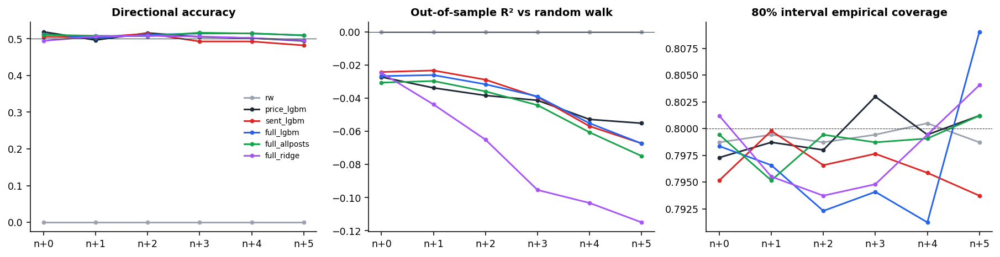
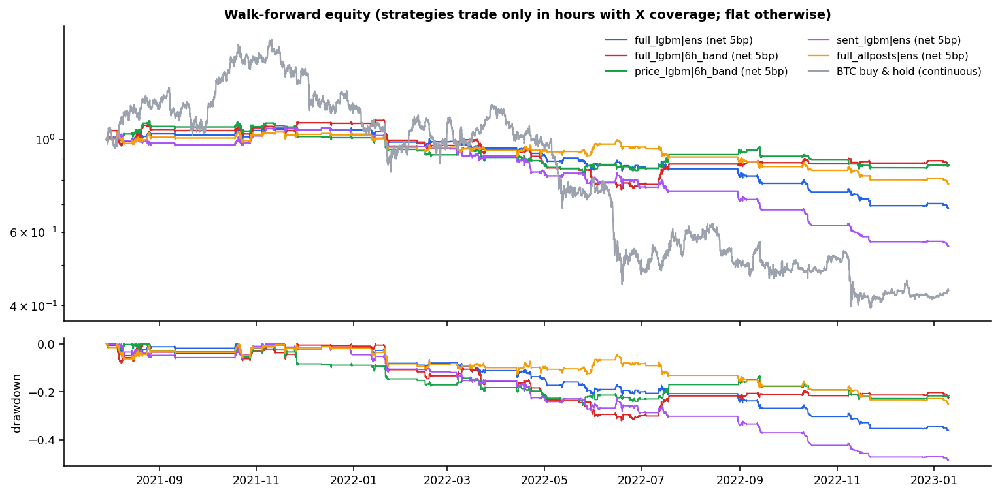
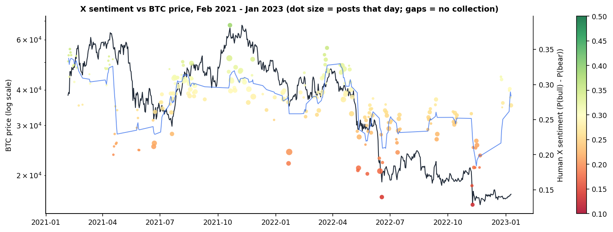
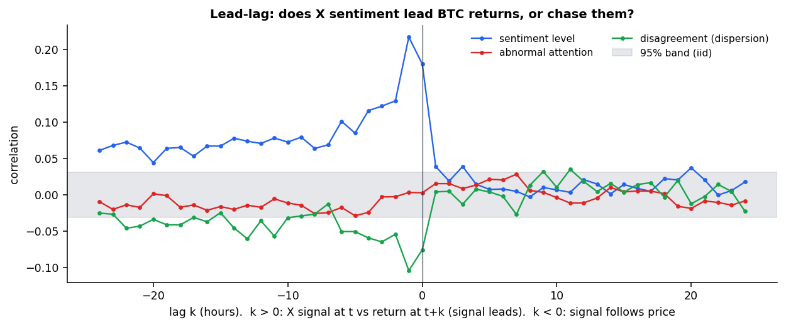
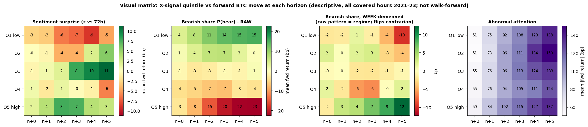
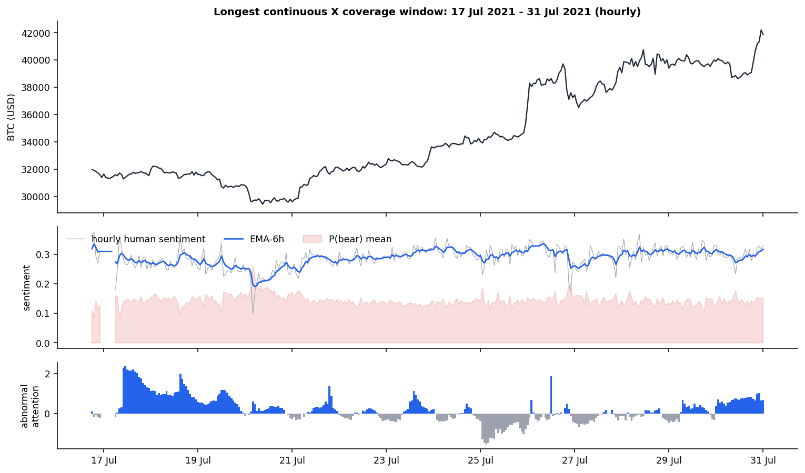
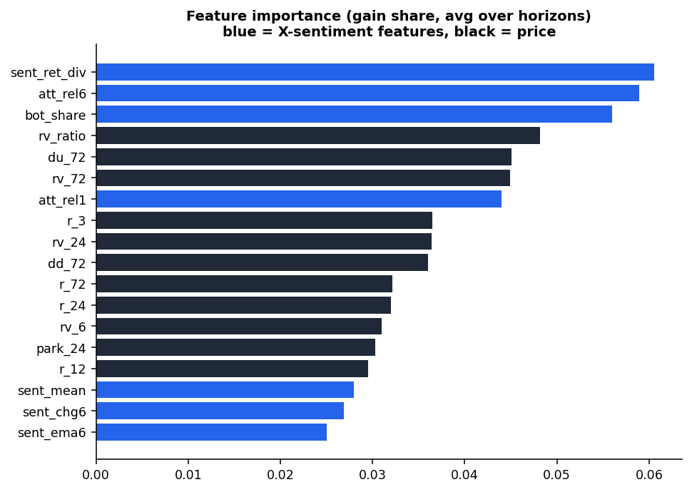
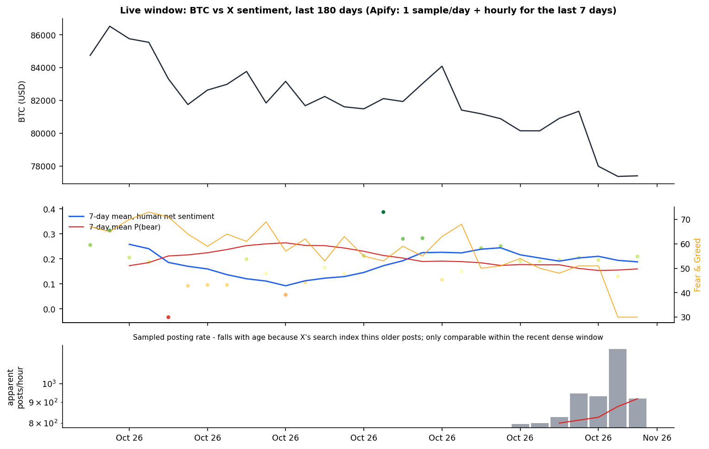
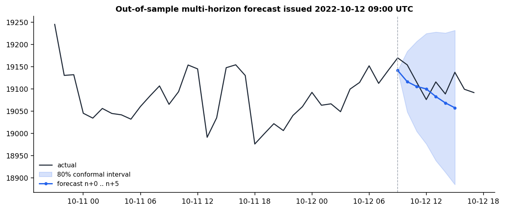

# CrowdWisdomTrading — X Sentiment Price Prediction Agent: Evaluation Report

Author: Jash Bharat Pasad (IIT Gandhinagar). Asset: Bitcoin (BTC/USDT, hourly). Forecast horizons n+0 … n+5 (1–6 hours ahead). Inputs: X sentiment and price only. All metrics below are out-of-sample from a purged expanding walk-forward; hyper-parameters were fixed before testing.

## 1. Executive summary

- **Data integrity first.** One of the suggested datasets (“Bitcoin Tweets 2025–2026”, Kaggle) is the 2021–23 corpus with every timestamp shifted +1,826 days (10,593/10,774 sampled rows identical; tweets stamped Feb 2026 quote BTC at ~$45k vs a real ~$68k). It was rejected; the original correctly-dated 4.69M-tweet corpus was used.
- **Domain sentiment model.** Trained on 510k author-labelled StockTwits crypto posts: bull-vs-bear AUC 0.862 vs VADER 0.575; 3-class macro-F1 0.52 vs 0.35; ~20,441 posts/s on one CPU.
- **Direction: no edge.** Across 2,807 out-of-sample hours (2021-07-29 → 2023-01-10) no model beats a random walk (OOS R² < 0 at every horizon; directional accuracy 48–52%). Adding X sentiment to a price model does not significantly change accuracy (Diebold–Mariano p > 0.18).
- **Trading.** Every long/short variant loses after 5 bp costs. Best: full_lgbm|6h_band with Sharpe -0.67 (90% CI -2.28 to 0.86), max drawdown -32%, Deflated Sharpe 0.06; BTC buy-and-hold over the same 2021-23 window: Sharpe -0.91, max drawdown -77%.
- **Where X sentiment does help: risk.** Adding X attention/disagreement to the HAR volatility model lowers QLIKE from 0.667 to 0.621 (DM t = -3.54, p = 0.0002). Vol-adaptive intervals fix the under-coverage of constant-width intervals in calm hours (76% → 83% vs 80% target).
- **X follows price.** Sentiment correlates 0.22 with the previous hour's return but only ~0.04 with the next hour's (lead–lag chart). The raw ‘high bearishness → negative returns’ pattern is a regime artefact: demeaned within each week it reverses into a mild contrarian bounce.

## 2. Data

| Source | What | Coverage / volume | Notes |
|---|---|---|---|
| Kaggle kaushiksuresh147 Bitcoin_tweets.csv | historical X posts (train/validate) | 4.69M posts → 4,039 covered hours, 4,007 model-eligible | malformed CSV rows dropped: 4,487 |
| Apify (live, last 180 days) | X posts, engagement, author followers | 5,807 posts in 478 hourly samples, 2026-10-03 → 2026-10-31; cost $3.45 | kaitoeasyapi actor (apidojo capped on free plan); budgeted hourly sampling |
| Binance spot archive (data.binance.vision) | BTCUSDT 1h OHLC | 2021-01 → 2026-10 | keyless, immutable files |
| Tavily (news) | recent BTC news | last 7 days | outlook only — not a model feature |

Coverage gaps in the historical corpus (220 well-covered days; longest unbroken run 15 days) mean post counts reflect the collector's effort. Attention is therefore measured relative to a trailing covered-hour baseline, and a row is modelled only if the previous hour has ≥ 50 posts. 47% of posts are automation-like (non-human client, templated text, account < 30 days, hashtag stuffing, price-ticker templates).

## 3. Method (summary — full detail in docs/METHODOLOGY.md)

- Timing contract: decision at the open of hour n with posts before it and closes to n−1; target y_h = log(close_n+h/close_n−1), so n+0 is a genuine 1-hour-ahead forecast. A unit test shocks all future data and asserts features are unchanged.
- Features (sentiment & price only): lagged returns, realised and Parkinson vol, drawdown; human-filtered net sentiment, bullishness index, bearish share (kept separate — negative-tone asymmetry), disagreement, bot share, abnormal attention, sentiment momentum/surprise, sentiment–price divergence.
- Model: one LightGBM per horizon on volatility-normalised targets (regime-comparable), Huber loss, heavy regularisation; split-conformal 80% intervals. Benchmarks on identical hours: random walk, price-only, sentiment-only, no-bot-filter, linear Ridge; HAR-RV for volatility.
- Validation: purged expanding walk-forward (initial 1,200 eligible hours, refit every 250, 6-hour purge). Deflated Sharpe uses all 12 directional strategy variants tried.

## 4. Forecast accuracy by horizon (out-of-sample)

| Model | h | OOS R² vs RW | Dir. acc. | IC | Price MAPE % | PI80 cover | PI80 width % |
|---|---|---|---|---|---|---|---|
| rw | n+0 | +0.0000 | 0.000 | – | 0.489 | 0.80 | 1.47 |
| rw | n+2 | +0.0000 | 0.000 | – | 0.860 | 0.80 | 2.73 |
| rw | n+5 | +0.0000 | 0.000 | – | 1.216 | 0.80 | 4.02 |
| price_lgbm | n+0 | -0.0272 | 0.519 | +0.011 | 0.493 | 0.80 | 1.49 |
| price_lgbm | n+2 | -0.0384 | 0.516 | +0.020 | 0.881 | 0.80 | 2.80 |
| price_lgbm | n+5 | -0.0551 | 0.494 | +0.004 | 1.273 | 0.80 | 4.21 |
| sent_lgbm | n+0 | -0.0242 | 0.505 | -0.005 | 0.495 | 0.80 | 1.50 |
| sent_lgbm | n+2 | -0.0289 | 0.514 | +0.021 | 0.882 | 0.80 | 2.78 |
| sent_lgbm | n+5 | -0.0673 | 0.482 | -0.042 | 1.270 | 0.79 | 4.08 |
| full_lgbm | n+0 | -0.0267 | 0.513 | +0.006 | 0.495 | 0.80 | 1.50 |
| full_lgbm | n+2 | -0.0316 | 0.511 | +0.022 | 0.888 | 0.79 | 2.77 |
| full_lgbm | n+5 | -0.0673 | 0.509 | +0.005 | 1.283 | 0.81 | 4.22 |
| full_allposts | n+0 | -0.0306 | 0.511 | +0.013 | 0.494 | 0.80 | 1.49 |
| full_allposts | n+2 | -0.0359 | 0.507 | +0.024 | 0.890 | 0.80 | 2.82 |
| full_allposts | n+5 | -0.0749 | 0.510 | -0.002 | 1.295 | 0.80 | 4.21 |
| full_ridge | n+0 | -0.0247 | 0.494 | +0.001 | 0.499 | 0.80 | 1.51 |
| full_ridge | n+2 | -0.0650 | 0.508 | +0.011 | 0.901 | 0.79 | 2.83 |
| full_ridge | n+5 | -0.1149 | 0.496 | -0.012 | 1.315 | 0.80 | 4.32 |

*Price MAPE is shown for completeness: it is tiny for every model (incl. the random walk) because P(t+h) ≈ P(t); it is not evidence of skill. OOS R² of returns vs a random walk is the meaningful number.*

| full_lgbm vs | n+0 (t, p) | n+2 | n+5 |
|---|---|---|---|
| rw | +3.27, 0.999 | +2.24, 0.988 | +3.04, 0.999 |
| price_lgbm | -0.11, 0.456 | -0.52, 0.300 | +0.58, 0.721 |
| full_allposts | -0.93, 0.177 | -0.73, 0.233 | -0.88, 0.191 |
| full_ridge | +0.21, 0.585 | -1.40, 0.081 | -1.36, 0.087 |

*Diebold–Mariano (squared error, HAC, HLN-corrected). Negative t ⇒ full_lgbm more accurate; p is one-sided.*

*Directional accuracy, OOS R² and interval coverage by horizon.*

## 5. Trading performance (required metrics)

| Strategy | Sharpe | Sharpe 90% CI | Sortino | Max DD | Calmar | Turnover/day | DSR |
|---|---|---|---|---|---|---|---|
| price_lgbm|h0 | -2.24 | -3.74 … -0.9 | -2.93 | -43.8% | -0.76 | 1.68 | 0.000 |
| price_lgbm|ens | -2.12 | -3.49 … -0.7 | -2.80 | -42.7% | -0.72 | 1.16 | 0.000 |
| sent_lgbm|h0 | -3.20 | -4.47 … -1.99 | -4.15 | -51.1% | -0.92 | 2.06 | 0.000 |
| sent_lgbm|ens | -2.78 | -4.23 … -1.44 | -3.64 | -48.6% | -0.84 | 1.76 | 0.000 |
| full_lgbm|h0 | -2.64 | -3.86 … -1.46 | -3.48 | -44.1% | -0.86 | 1.87 | 0.000 |
| full_lgbm|ens | -1.83 | -3.06 … -0.58 | -2.50 | -36.2% | -0.72 | 1.30 | 0.001 |
| full_allposts|h0 | -1.99 | -3.21 … -0.81 | -2.76 | -36.1% | -0.78 | 1.84 | 0.001 |
| full_allposts|ens | -1.19 | -2.43 … 0.02 | -1.66 | -25.3% | -0.67 | 1.26 | 0.013 |
| full_ridge|h0 | -1.13 | -2.43 … 0.23 | -1.60 | -27.6% | -0.58 | 1.37 | 0.017 |
| full_ridge|ens | -1.34 | -2.65 … 0.02 | -1.86 | -30.8% | -0.63 | 1.10 | 0.008 |
| price_lgbm|6h_band | -0.72 | -2.09 … 0.6 | -0.99 | -25.3% | -0.39 | 0.36 | 0.051 |
| full_lgbm|6h_band | -0.67 | -2.28 … 0.86 | -0.94 | -32.0% | -0.31 | 0.37 | 0.056 |
| buy_hold_covered_hours | -1.02 | -2.43 … 0.33 | -1.39 | -55.0% | -0.61 | 0.32 | – |
| buy_hold_continuous | -0.91 | -2.24 … 0.39 | -1.26 | -77.2% | -0.74 | 0.00 | – |
| full_lgbm|ens@0bps | -0.16 | -1.4 … 1.12 | -0.22 | -17.1% | -0.13 | 1.30 | – |
| full_lgbm|ens@10bps | -3.48 | -4.67 … -2.21 | -4.67 | -53.2% | -0.94 | 1.30 | – |

*Hourly net returns after 5 bp per unit turnover (rows marked @0bps/@10bps show cost sensitivity), annualised with √8760. Strategies are flat in hours without X coverage. h0 = 1h-ahead signal; ens = horizon-averaged signal; 6h_band = decide every 6h on the n+5 forecast with a 0.25 no-trade band (added after round 1, counted in DSR).*

*Walk-forward equity and drawdown.*

## 6. Volatility: where X sentiment adds information

| Model | MSE log-RV | QLIKE | R² vs HAR | corr |
|---|---|---|---|---|
| har | 1.167 | 0.667 | +0.000 | 0.636 |
| har_x | 1.177 | 0.621 | -0.009 | 0.644 |
| price_gbm | 1.320 | 0.687 | -0.132 | 0.592 |
| full_gbm | 1.345 | 0.658 | -0.153 | 0.599 |

| Comparison | DM on MSE (t, p) | DM on QLIKE (t, p) |
|---|---|---|
| har_x_vs_har | +0.78, 0.781 | -3.54, 0.0002 |
| full_gbm_vs_price_gbm | +1.20, 0.884 | -1.73, 0.0416 |
| full_gbm_vs_har | +2.54, 0.994 | -0.24, 0.4036 |
| price_gbm_vs_har | +2.33, 0.990 | +0.49, 0.6876 |

*Target: log realised variance over n..n+5. QLIKE (Patton 2011) is the robust loss for variance forecasts and penalises under-predicting volatility spikes. The gain is on QLIKE, not on MSE of log-RV.*

| n+5 80% interval | coverage all | calm hours | turbulent hours | mean width % |
|---|---|---|---|---|
| adaptive | 0.840 | 0.826 | 0.855 | 4.17 |
| constant | 0.810 | 0.758 | 0.868 | 4.03 |

| Vol-managed long (covered hours) | Sharpe* | Sortino* | Max DD | Ann. vol* |
|---|---|---|---|---|
| long_unmanaged | -2.17 | -2.95 | -55.0% | 0.70 |
| vol_managed_har | -2.75 | -3.65 | -52.5% | 0.62 |
| vol_managed_har_x | -2.95 | -3.95 | -52.9% | 0.60 |
| vol_managed_full_gbm | -3.92 | -5.16 | -58.9% | 0.57 |

**annualised per active hour (covered hours only), so comparable across rows but not with §5. Better variance forecasts did not translate into better risk-adjusted returns in this mostly-bear sample: honest negative result.*

## 7. Visual matrix: X sentiment vs price through time

*Daily human X sentiment vs BTC, 2021–23.*

*Lead–lag: sentiment reacts to past returns; almost no lead on future returns.*

*Signal quintile × horizon. Raw bearish-share pattern is a regime effect; week-demeaned it flips contrarian.*

*Hourly zoom on the longest continuous coverage window.*

*Feature importance (gain).*

## 8. Live window (Apify, X posts 3–31 Oct 2026; prices for the last 180 days)

| Model (trained on 2021-23 only) | h | OOS R² vs RW | Dir. acc. | PI80 cover |
|---|---|---|---|---|
| rw | n+0 | +0.0000 | 0.000 | 0.79 |
| rw | n+5 | +0.0000 | 0.000 | 0.77 |
| price_lgbm | n+0 | +0.0182 | 0.583 | 0.78 |
| price_lgbm | n+5 | -0.0501 | 0.442 | 0.74 |
| full_lgbm | n+0 | +0.0112 | 0.545 | 0.79 |
| full_lgbm | n+5 | -0.0494 | 0.513 | 0.74 |

*156 dense hourly samples, 2026-10-25 06:00 → 2026-10-31 17:00 UTC. Too few hours for inference — a transfer smoke test showing the 2021-23 model and its intervals behave sensibly in 2026.*

*Live window: 180 days of price and Fear & Greed; X sentiment available 3–31 Oct 2026 (scrape budget/time-limited).*

*Example out-of-sample multi-horizon forecast with 80% conformal band.*

## 9. Self-critique and threats to validity

- Historical X data is a sampled, gappy corpus (2021-23); live data is a budget sample (~20 posts per sampled hour). Neither is the full firehose. Effects that need dense data (minute-level, Guégan & Renault 2021) are out of reach.
- The test period is dominated by the 2022 bear market. Results may differ in trending bull regimes.
- Low-turnover and vol-managed variants were added after seeing round-1 results. They are disclosed and counted in the DSR rather than hidden. The volatility hypothesis was pre-specified from the literature, not data-mined.
- The sentiment model is trained on StockTwits labels and applied to X (domain shift). A CryptoBERT re-score of a sample is the next check.
- Post-level bot detection is heuristic (no ground truth). The all-posts vs human ablation shows no significant difference in accuracy.
- With a paid Apify plan the same code scales to dense hourly coverage for 180 days (≈ 430k posts, ≈ US$110–170). That is the single biggest improvement available.

## 10. Reproduce

pip install -r requirements.txt; cp .env.example .env (add APIFY_TOKEN, TAVILY_API_KEY); then make all (audit → data → sentiment → hourly → backtest → vol study → charts → scrape → live → report). make test runs the look-ahead tests.
